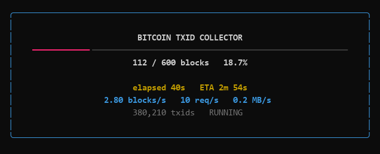
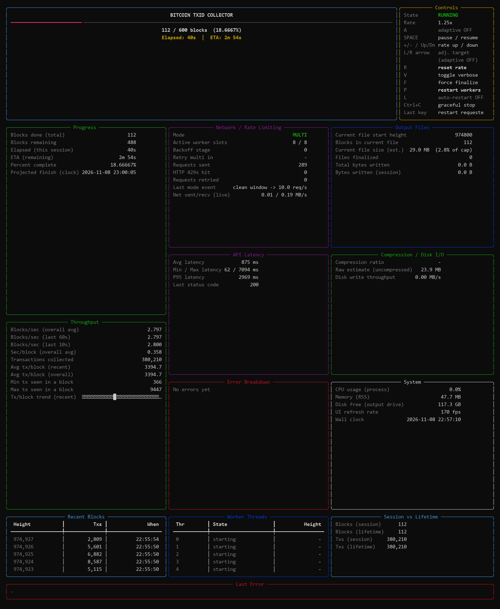

# Bitcoin txid archive

Fetches the **ordered transaction ids of every Bitcoin block** and stores them as
Parquet — two HTTP requests per block, one row per transaction, no chain download.
With the txid list plus a block's 80-byte header you can recompute its Merkle root
and prove the contents match the header, without ever holding the transactions.

## Why not Blockchair, AWS, BigQuery or a full node

All of them hand you the complete transaction record when you only want the
hashes. The record is roughly ten times the bytes.

| Source | What actually arrives | Size |
|---|---|---|
| Full node (`bitcoind`) | every block, every input, every output | ~700 GB |
| Blockchair dumps | TSV.gz, all fields; 10 kB/s unless you ask nicely | ~80 GB compressed for transactions alone, plus 700 GB of inputs and 220 GB of outputs |
| AWS Public Blockchain | Parquet with nested input/output arrays per row | hundreds of GB to pull, or Athena scans |
| BigQuery `crypto_bitcoin` | 2 TB table | free to store, $6.25/TiB to read |
| **this repo** | 32-byte ids, in block order | **~67 bytes per txid on disk; the full chain lands near 85 GB** |

The number that matters on a slow or metered link is not the total — it is the
**smallest useful unit**. Every mainstream source is all-or-a-huge-chunk. Here it
is **one block, about 250 KB**, fetched independently.

That changes the arithmetic completely:

- On a 20 GB/month cap, a full-history run is ~5 months of quiet background work
  rather than a download that never finishes.
- Stop at any block, at any second. Resume continues from the exact block that
  was in flight: the in-progress file is a text WAL fsynced per block, so a
  dropped connection costs one block, not one archive.
- No `.tar` to restart, no cloud account, no egress bill, no per-query charge.
- It backs off instead of getting you banned. The rate controller cuts on HTTP
  429 and remembers the rate that caused it, so a multi-day run against a
  donation-funded public API stays polite.

The trade-off is honest: this is not a copy of the chain. It is the skeleton you
need to *verify* the chain, or to feed an indexer, or to prove a transaction was
in a block given a header.

## How long does the entire history take

Full history is about 975,000 blocks at today's tip, and every block costs
exactly two requests (`/block-height/{h}`, then `/block/{hash}/txids`). So the
arithmetic is fixed: **1,950,184 requests**, and wall time is `2 × blocks ÷ rps`.

| Sustained rate | Threads needed | Full history | Data on disk |
|---|---|---|---|
| 4 req/s | 2 | 5.6 days | ~90 GB |
| 8 req/s (default) | 4 | 2.8 days | ~90 GB |
| 16 req/s | 8 | 34 hours | ~90 GB |
| 32 req/s | 16 | 17 hours | ~90 GB |
| 64 req/s | 32 | 8.5 hours | ~90 GB |

The size assumes ~1,300 transactions per block across history at the measured 67
bytes per txid on disk; recent blocks carry ~3,700, so a recent-only range runs
about 2.7x denser per block. Treat it as ±10%.

Throughput is capped at `threads ÷ latency`, so at ~0.5 s round trips you need
roughly `rps ÷ 2` workers. Threads beyond that buy nothing — the rate limiter
is the binding constraint, not the network.

Read that table with one caveat: only the slow rows are verified. 17 req/s ran
clean for minutes against mempool.space; above that is untested and probably
unwelcome on a donation-funded API. Run `A_speed_probe.py` once and it records a
ceiling the collector then respects permanently. The rate is a courtesy setting,
not a technical limit of this tool.

At 64 req/s you would be pulling ~10 GB an hour, so on long runs **storage is the
constraint, not time**. If all you want is a specific year, take a date range —
2024 is ~52,500 blocks, roughly 3.6 hours at 8 req/s.

## Files

| Path | What it does |
|---|---|
| `Run txid collector.bat` | Double-click entry point. Opens a console, runs the questionnaire, then hands the same window to the collector. |
| `src/A_launcher.py` | The questionnaire: what to download (txids / merkle roots / headers), then run type (resume / recent / date range / capped / full / dry), threads, base rate, file cap, theme, verification, output folder. Ends by launching the collector with the flags you chose. |
| `src/A_txid_collector.py` | The collector. Rate-limited worker pool, WAL + checkpoint, parquet writer, live dashboard, hotkeys. This is the program that does the work. |
| `src/A_speed_probe.py` | Finds the fastest *sustained* request rate the API tolerates, by holding each rate for a full dwell. Writes `speed_profile.json`, which the collector reads as a hard ceiling. |
| `requirements.txt` | `requests`, `pyarrow`, `rich`, `psutil`. Only the collector and launcher need them; the probe needs `requests` only. |
| `SCHEMA.md` | Exact Parquet columns, WAL text format, checkpoint and stats fields, resume rules. |
| `build.bat` | Builds the single-file executable into `dist\txid-collector.exe`. |
| `data/` | All downloads live here: parquet files, `roots.csv`, `headers.csv`, WAL, checkpoint, log, stats, speed profile. Ignored by git. |
| `docs/` | Dashboard screenshots used above. |

## Using it

Double-click `Run txid collector.bat`. Answer the questions with arrow keys and
Enter; numbers and date stamps are typed. The summary screen shows the exact
command before anything runs.

Date ranges use one stamp per boundary, `YYYY/MM/DD/HH/MM`, minutes in tens, UTC:

```
Start [2026/10/09/00/00]: 2024/01/01/00/00
End   [2026/11/08/00/00]: 2024/01/31/23/50
-> blocks 823,786 to 831,400  (7,615 blocks)
```

Start takes the first block at or after the stamp; end takes the last block at or
before it. Defaults are `00/00`, so a plain date range is midnight to midnight.

## Single-file executable

`build.bat` produces `dist\txid-collector.exe` — about 40 MB, PyInstaller, no
Python needed on the machine that runs it:

```bat
build.bat
```

The build happens inside a throwaway `.venv-build` holding only the four runtime
dependencies. Building against a full system Python is what makes a naive
PyInstaller run crawl and then abort on "attempt to collect multiple Qt bindings";
the venv avoids both problems and produces a far smaller binary.

The exe is the same program with three entry points:

```bat
txid-collector.exe                                            :: questionnaire
txid-collector.exe --cli --store roots --max-blocks 500       :: straight to the collector
txid-collector.exe --probe --dwell 180 --max-steps 6          :: the rate probe
```

Anything it downloads goes to `data\` **next to the exe**, so put the exe where
you want the archive to live. `Run txid collector.bat` remains the entry point
for running from a source checkout.

## Without the bat

Everything is a normal CLI program; the bat only calls the launcher.

```bat
python src\A_launcher.py                                    :: questionnaire only
python src\A_txid_collector.py                              :: full history, resumes automatically
python src\A_txid_collector.py --start-height 974400 --max-blocks 500
python src\A_txid_collector.py --start-height 823786 --end-height 831400
python src\A_txid_collector.py --dry-run                    :: 3 blocks into data\dryrun
python src\A_txid_collector.py --quiet                      :: no dashboard, one line per 5s
python src\A_speed_probe.py --dwell 180 --max-steps 6       :: measure a safe rate first
```

Flags worth knowing:

| Flag | Meaning |
|---|---|
| `--start-height` / `--end-height` | Inclusive block range. Defaults 1 to 958052. |
| `--max-blocks N` | Window of N blocks from the resume point; overrides the end height. |
| `--output-dir PATH` | Where parquet and state go. Default `data/`. |
| `--max-threads N` | Worker threads (default 8). |
| `--multi-rps N` | Base request rate; the controller adjusts from here (default 8). |
| `--file-cap-bytes N` | Max size per parquet file (default 1 GiB); the overflow block rolls to the next file. |
| `--verify-ntx` | Extra request per block to confirm the tx count. |
| `--store txids\|roots\|headers` | What to keep per block: every txid (default), one Merkle root, or the 80-byte header. |
| `--theme dark\|neon\|mono`, `--compact`, `--no-fullscreen`, `--verbose` | Dashboard appearance. |

Hotkeys while it runs: `Space` pause, `+`/`-` rate, `R` reset rate, `V` verbose,
`F` force-finalise the current parquet, `P` restart workers, `L` auto-restart,
`Ctrl+C` stop cleanly.

## Dashboard

Three layouts, chosen in the questionnaire — **minimal is the default**.

Minimal: progress, ETA, speed. Nothing else.



Full: throughput, latency percentiles, worker states, error breakdown,
compression, disk and system panels.



`--compact` is the middle option: the same panels in two columns for shorter
terminals.

## Output

`data/<start>-<end>.parquet`, snappy, two columns: `marker` (int64 — the block
height on a marker row, the 1-based position on a tx row) and `txid` (string,
empty on marker rows). Files are capped at 1 GiB and named after the range they
hold, so the directory listing is the coverage map. See `SCHEMA.md`.

A full run is resumable at any moment. Deleting `checkpoint.json` but keeping a
WAL rebuilds the true position by replaying the WAL locally, with no network.

With `--root-only` there are no parquet files at all. Each block's txids are
ladder-hashed in memory as they arrive and the result is appended as
`height,merkle_root` to `data/roots.csv` — about 72 bytes per block, **roughly
70 MB for the entire chain against ~90 GB**. Every root is byte-identical to the
block header's `merkle_root`, so the file is evidence that the txid lists hashed
correctly, not merely a copy of the headers. Resume is just the last line of the
file plus one.

With `--store headers` each line holds the six header fields —
`height,version,prev_hash,merkle_root,time,bits,nonce`. That is the entire 80-byte
header, so the block hash can be recomputed from the file itself (verified: all
15 sampled blocks rebuild to their real hash). About 150 bytes a line, ~150 MB for
the chain, and it carries proof-of-work, which roots alone do not.

## Notes

- mempool.space is a free, donation-funded public service. Do not point a naive
  loop at it. Run `A_speed_probe.py` once, let it record a ceiling, and the
  collector will respect it permanently.
- No API key, no account, no telemetry. The only network calls are to the API
  base you pass (`--api-base`).

## Donations

If this saved you a week of waiting, or a few hundred gigabytes or dealing with other issues and you'd like to support me:

```
Bitcoin   bc1qxx64jxqyu07au6w6c4lv79s9p8nk9hlkjegclz
Solana    BB1bFKdr3AAJ2X4STDXDLMCW16R9Y1BTa9CqMK5QWVi3
EVM       0xfb1f8109c07ea777D6d0852afC6e0e21a2658802
Tron      TEoqPtUpMvQkj8YgVCXaMkqK6b7a8ZnaSS
Ton       UQAyO7eFPtNBFW_gElZSY6B_E-i5GwJqzmHQ2d5rARoqQmOX
```

